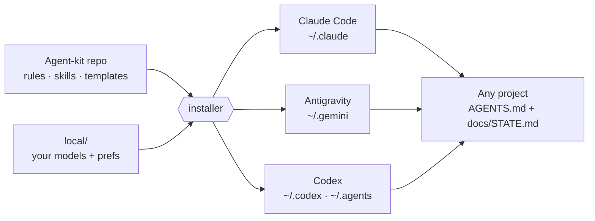

<div align="center">

# Agent-kit

**One set of rules and skills for your AI coding agents.**
Claude Code, Antigravity (Gemini) and Codex all follow the same workflow, from a new idea to a published release.

[](https://github.com/Eurie92/Agent-kit/actions/workflows/ci.yml)
[](https://github.com/Eurie92/Agent-kit/releases)
[](LICENSE)


[Install](#install) · [Daily use](#daily-use) · [How it works](#how-it-works) · [Contributing](CONTRIBUTING.md) · [Changelog](CHANGELOG.md)

</div>

---

## Why

Every agent tool has its own rule files, and every thread starts from zero. Agent-kit gives all of them **one shared playbook**:

| | |
|---|---|
| ⚡ **No ceremony on small jobs** | A bug or tweak gets done right away, with a failing test or a screenshot as proof. |
| 📐 **Process only when it pays** | Real features get a scope pick, a short spec, a plan, then proof. |
| 🧠 **Memory in files, not chat** | Say `save` at the end, `boot` in the next thread. Threads stay short and cheap. |
| 🔍 **Outside review** | High-stakes work gets audited by a model from another vendor before it ships. |
| ✋ **You stay in control** | Nothing merges to main, deploys or publishes without your "yes". |
| 🧩 **Yours, not ours** | Your models, accounts and chat style live in git-ignored `local/` files. |

## Install

You need **git**, plus Windows PowerShell 5.1+ (Windows) or bash (macOS, Linux; the macOS default bash 3.2 works). No admin rights.

### Option 1: let your agent do it (recommended)

Open Claude Code, Antigravity or Codex and say:

> Install Agent-kit from https://github.com/Eurie92/Agent-kit. Follow its INSTALL.md.

The agent clones the kit to `~/Desktop/Agent-kit` and runs the **`setup`** interview:

1. Reads your existing global rules and skills, and reports any clashes.
2. Asks one question at a time: tools, models and accounts, routing, auditor, chat style, effort, your own always/never rules.
3. Writes your answers to `local/MODELS.md` and `local/PREFS.md`.
4. Runs the installer as a dry run, shows you the result, then installs and checks it.

Change your answers any time: say `setup`.

### Option 2: by hand

<details>
<summary><b>Windows (PowerShell)</b></summary>

```powershell
git clone https://github.com/Eurie92/Agent-kit "$HOME\Desktop\Agent-kit"
cd "$HOME\Desktop\Agent-kit"
mkdir local
copy rules\MODELS.example.md local\MODELS.md   # edit: pick a preset, set your models
notepad local\PREFS.md                          # chat style and personal rules (format in skills/setup/SKILL.md)
powershell -ExecutionPolicy Bypass -File install\install.ps1 -DryRun   # preview
powershell -ExecutionPolicy Bypass -File install\install.ps1           # install
```
</details>

<details>
<summary><b>macOS / Linux (bash)</b></summary>

```bash
git clone https://github.com/Eurie92/Agent-kit ~/Desktop/Agent-kit
cd ~/Desktop/Agent-kit
mkdir -p local
cp rules/MODELS.example.md local/MODELS.md   # edit: pick a preset, set your models
nano local/PREFS.md                          # chat style and personal rules (format in skills/setup/SKILL.md)
bash install/install.sh --dry-run            # preview
bash install/install.sh                      # install
```
</details>

| Option | Windows | macOS / Linux |
|---|---|---|
| Preview only | `-DryRun` | `--dry-run` |
| Some tools only | `-Harness claude,gemini` | `--harness claude,gemini` |
| Remove everything it added | `-Uninstall` | `--uninstall` |

> [!NOTE]
> Keep the kit at `~/Desktop/Agent-kit`; the rules and skills point there. The installer stops without changing anything if `local/MODELS.md` or `local/PREFS.md` is missing, and backs up every file it touches to `~/.agent-kit-backups/`.

## Daily use

Open a new thread in any project and talk normally. These words steer the flow:

| You say | What happens |
|---|---|
| `boot` | The agent reads the project's `AGENTS.md` and `docs/STATE.md` and picks up where you left off. Missing? It offers to create them. |
| *"fix the login bug"* | Small job: it writes a failing test, fixes it, shows the test passing. |
| *"add dark mode"* | Real feature: you pick **minimal / balanced / hardened**, approve a short spec, then it plans, builds and proves it. |
| `/kickoff` or `kickoff` | New project: brainstorm, stack research, spec, plan, scaffold. |
| `audit` | A model from another vendor reviews the spec, plan or diff. It reports; it never edits. |
| `ship` | Release gate: checklist, secrets scan, audit for high-stakes work, then waits for your "yes". |
| `save` | Writes progress to `docs/STATE.md` so the next thread can `boot`. Use it at the end of a session. |
| `setup` | Change your models, auditor, chat style or personal rules. |

**A typical session**

```text
you:    boot
agent:  Read STATE: last done = checkout page; next = email receipts.
you:    add email receipts
agent:  Non-trivial. Pick: minimal (~1 h) / balanced (~3 h, recommended) / hardened (~1 day).
you:    balanced
agent:  Spec Part A: ... approve?
you:    yes
agent:  ...builds on feat/email-receipts... tests: 14 passed. Pushed.
you:    save
```

## How it works



- **Rules** (`rules/GLOBAL.md` + your `local/` files) load in every thread, so they stay short.
- **Skills** load only when a task needs them: `setup`, `kickoff`, `feature`, `handoff`, `ship`, `audit`, `playbooks`, `standards`.
- **Project facts** live in each project's `AGENTS.md` and `docs/` (templates in `templates/project/`).

**Model layers.** Pick a preset in `rules/MODELS.example.md`; yours lives in `local/MODELS.md`. A lead model works in your thread and does small jobs itself. It hands parallel, bulk or research work to cheaper workers, asks an advisor model on rare hard calls, and can send high-stakes work to an optional outside auditor.

**How delegation works.** There is no separate orchestrator program. Delegation is rules plus your harness:

1. `rules/GLOBAL.md` §4 tells the lead when to delegate: independent parts that can run in parallel, research beyond a couple of searches, full test or lint runs, reading more than about 5 files, and audits at gates. Small work stays with the lead.
2. `local/MODELS.md` says which model does each layer and on which account.
3. The harness runs the worker. In T3 Code the lead calls `delegate_task` (for example with `providerInstanceId: "claudeTeam2"` for a second Claude account); in Claude Code alone it uses native subagents. Each worker gets a written brief and returns pass or fail, errors and files touched.
4. The lead reviews every worker result before using it.

Headless runs (`claude -p`, scripts) have no T3 tools, so they fall back to native subagents or do the work in one thread.

Delegation is for big work. On a build a strong lead finishes in under about 15 minutes, the lead keeps everything itself, by design. In our own tests so far the kit's measured gains came from git hygiene, recorded decisions and docs, not from delegation.

<details>
<summary><b>Where the installer writes</b></summary>

| Tool | Rules | Skills |
|---|---|---|
| Claude Code | `@` imports of `rules/GLOBAL.md`, `local/MODELS.md`, `local/PREFS.md` in `~/.claude/CLAUDE.md` | links in `~/.claude/skills/` |
| Antigravity | a copy of those three files in `~/.gemini/GEMINI.md` | copies in `~/.gemini/config/skills/` (it does not follow links there) |
| Codex | a copy of those three files in `~/.codex/AGENTS.md` (32 KiB cap) | links in `~/.agents/skills/` |

- Links are directory junctions on Windows and symlinks on macOS and Linux.
- The installer writes only between `agent-kit:start` and `agent-kit:end` markers and updates that block in place. Your own lines stay.
- Broken markers, or a skill folder with the same name that is not the kit's: skipped with a warning.
- Skills removed from the kit are unlinked on the next run.
- Antigravity's skill copies are rebuilt from the kit (after a backup). Edit the kit, not the copies.
- After editing the kit, re-run the installer: Gemini and Codex hold copies.
</details>

<details>
<summary><b>Using Antigravity inside T3 Code</b></summary>

T3 Code runs Antigravity with a private Gemini home and links in only the skills folder. There it loads skills but no rule files: not the global ones (tested: `GEMINI.md` in the home root, `config/GEMINI.md`, `config/rules/`) and not the project's `AGENTS.md` or `.agents/rules/`. So the `handoff` skill's `boot` step and each project's `AGENTS.md` tell the agent to read the kit rules itself when they are missing. **In T3, start every Antigravity thread with `boot`.**
</details>

<details>
<summary><b>Repo layout</b></summary>

```text
INSTALL.md              instructions for an agent installing the kit
rules/
  GLOBAL.md             always-on rules for every project and tool
  MODELS.example.md     model layers and routing presets
local/                  your settings, git-ignored (written by setup)
skills/
  setup/                interview → local/ → install → verify
  kickoff/              idea → research → spec → plan → scaffold
  feature/              scope pick → spec → plan → build → proof
  handoff/              save / boot through docs/STATE.md
  ship/                 pre-publish gate
  audit/                outside review by another vendor's model
  playbooks/            per project type: web, bot, extension, app, ...
  standards/            proven standards per field, cited in specs
templates/project/      AGENTS.md + docs (STATE, SPEC, PLAN, DECISIONS, LESSONS, RESEARCH)
install/                install.ps1, install.sh and their tests
tools/check.sh          repo checks (also run by CI)
docs/                   this kit's own spec, plan, decisions and lessons
```
</details>

## FAQ

<details>
<summary><b>Do I need all three tools?</b></summary>

No. Install for the ones you use: `--harness claude` (or `-Harness claude` on Windows). `setup` asks and does this for you.
</details>

<details>
<summary><b>Will it overwrite my own CLAUDE.md / GEMINI.md / AGENTS.md?</b></summary>

No. It only manages the block between its markers, keeps everything else byte for byte (line endings too), and backs up the file first. `--uninstall` removes only what it added.
</details>

<details>
<summary><b>I only have one AI vendor. Does the audit still work?</b></summary>

Yes. With no outside auditor, `audit` has the advisor model review in a fresh context. It is weaker than a second vendor, but better than self-review.
</details>

<details>
<summary><b>How do I update?</b></summary>

`git pull` in the kit folder, then re-run the installer. Your `local/` files are never touched by updates.
</details>

## Why it is built this way

- **Short rules, lazy skills.** Rules load into every prompt, so they stay small. Skills load only when needed.
- **Size the task first.** Most work is small. A spec for a one-line fix wastes time and tokens.
- **Another vendor reviews.** A model is a weak judge of its own work.
- **Files beat long threads.** A thread that auto-compacts loses detail and costs more each turn. `save` writes a 60-line state file; a fresh thread `boot`s from it.
- **`local/` for taste.** Shared rules stay the same for everyone. Your choices stay on your machine, so updates never overwrite them and sharing never leaks them.

## Contributing

New playbooks, standards sheets, installer fixes and clearer rules are all welcome. Read [CONTRIBUTING.md](CONTRIBUTING.md). CI runs the repo checks and both installers' tests on Windows, macOS and Linux for every pull request.

## Credits

Much of the rule set is adapted, in our own words, from [Aedwon's agent workflow](https://aedwon.site/workflow): the talk rules, the org chart and escalation path, the top-down spec flow, scope sizes, the standards library, decision records, proof before done, the outside audit and the lessons process. Thanks, Aedwon.

Where this kit differs: a `setup` interview writes each user's own models and chat style; merging to main needs the user's OK; bugs skip the spec flow; the `save`/`boot` handoff comes from another friend's setup; the outside auditor is optional and runs async.

## License

[MIT](LICENSE)
